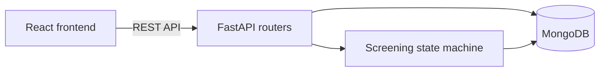
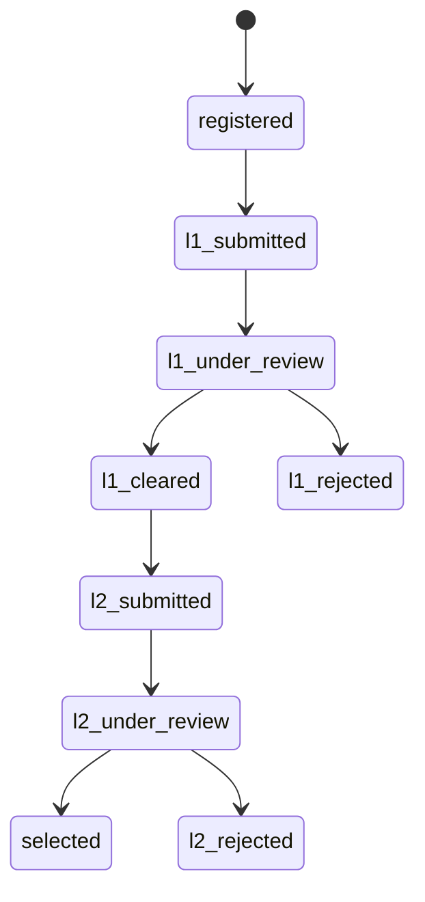

# Ignite: SIH 2026 Portal


The internal Smart India Hackathon 2026 portal for Nagarjuna College of Engineering and Technology. Ignite supports the full internal hackathon process: promotion, awareness, team registration, two-level screening, results, and student-led promotion.

Built by **Partha Shankar** (full-stack) and **Nirmith M Jain** (frontend design), students at the college and coordinators for its internal hackathon.

## Overview

Ignite gives participants one place to learn about the hackathon, register a team, and follow its progress, while giving coordinators the tools to review submissions and publish results. Its visual identity is built around a single concept, the Spark Thread, described in [`docs/DESIGN_SYSTEM.md`](docs/DESIGN_SYSTEM.md).

## Key Features

- **Public site:** landing page, timeline, rules, problem statements, FAQ, gallery, updates, and an interactive 3D Spark Story
- **Team registration:** team creation, member management, and global USN uniqueness validation
- **Participant dashboard:** team status, members, submissions, and announcements
- **Screening workflow:** a two-level state machine with an audit log entry for every transition
- **Coordinator console:** registrations, screening, team locking and editing, content editing, and announcements
- **Spread the Spark:** student promotion sharing that requires no login
- **Results:** publication of hackathon results

## Technology Stack

| Layer | Technology |
| --- | --- |
| Frontend | React 19, TypeScript, Vite, Tailwind CSS 4, TanStack Query, React Router |
| Animation and 3D | Three.js, GSAP, Framer Motion |
| Backend | FastAPI, Uvicorn, Pydantic |
| Database | MongoDB with Motor |
| Authentication | JSON Web Tokens, bcrypt |
| Deployment | Cloudflare Pages (frontend), Render (backend) |

## Architecture and Workflow



### Screening States



## Project Structure

```text
Sih2026/
├── backend/
│   ├── app/
│   │   ├── core/          Configuration, security, cache, and rate limiting
│   │   ├── db/            MongoDB connection and seeding
│   │   ├── models/        Data models
│   │   ├── routers/       API routes
│   │   ├── services/      Screening state machine
│   │   └── main.py        Application entry point
│   ├── render.yaml        Render deployment configuration
│   └── requirements.txt
├── frontend/
│   └── src/
│       ├── api/           API client
│       ├── components/    Layout, interface, and 3D components
│       └── pages/         Public, dashboard, and admin pages
├── docs/                  Project documentation
├── DEPLOYMENT.md
└── RUN_LOCALLY.md
```

## Installation and Setup

### Prerequisites

- Python 3.11
- Node.js
- A MongoDB database, local or Atlas

### Backend

```bash
cd backend
python -m venv venv
```

Activate the virtual environment:

```bash
source venv/bin/activate      # Linux and macOS
venv\Scripts\activate         # Windows
```

Install the dependencies and start the server:

```bash
pip install -r requirements.txt
python -m uvicorn app.main:app --reload --port 8000
```

### Frontend

```bash
cd frontend
npm install
npm run dev
```

The application runs at `http://localhost:5173`, and the interactive API documentation at `http://localhost:8000/docs`.

## Configuration

Copy `backend/.env.example` to `backend/.env` and provide your values.

| Variable | Purpose |
| --- | --- |
| `MONGODB_URI`, `MONGODB_DB_NAME` | Database connection |
| `JWT_SECRET`, `JWT_ALGORITHM`, `ACCESS_TOKEN_EXPIRE_MINUTES` | Authentication tokens |
| `CORS_ORIGINS` | Allowed frontend origins |
| `APP_NAME`, `ENVIRONMENT` | Application settings |

The frontend reads `VITE_API_URL` for the backend address and defaults to `/api/v1`.

## Usage

Participants register a team, add its members, and follow its status from the dashboard. Coordinators sign in through the admin pages to review teams, publish updates, and manage content. See [`RUN_LOCALLY.md`](RUN_LOCALLY.md) for a step-by-step local walkthrough.

### API Overview

All routes use the `/api/v1` prefix, except the root and health routes.

| Prefix | Purpose |
| --- | --- |
| `/auth` | Registration and login |
| `/teams` | Teams, members, and screening actions |
| `/problem-statements` | Problem statements |
| `/announcements` | Announcements |
| `/content` | Editable site content |
| `/results` | Hackathon results |
| `/stats` | Portal statistics |
| `/promotions` | Student promotion sharing |

The `/health` route supports deployment health checks. See [`docs/API.md`](docs/API.md) for the endpoint reference.

## Technical Implementation

### Screening State Machine

`backend/app/services/screening.py` is the only code permitted to change a team's status. It validates each change against the allowed transitions, rejects invalid moves with HTTP 409, and writes an audit log entry, so a team's review history can be reconstructed.

### Performance and Reliability

The backend includes in-memory endpoint caching for read operations, rate limiting, a concurrency-limiting request queue, security headers, and a global exception handler. Database indexes and connections are managed through the MongoDB layer.

## Documentation

| Document | Covers |
| --- | --- |
| [`RUN_LOCALLY.md`](RUN_LOCALLY.md) | Local setup and start commands |
| [`DEPLOYMENT.md`](DEPLOYMENT.md) | Deployment to Cloudflare Pages and Render |
| [`docs/ARCHITECTURE.md`](docs/ARCHITECTURE.md) | System overview, data flow, and roles |
| [`docs/FRONTEND.md`](docs/FRONTEND.md) | Routes, components, and data sources |
| [`docs/BACKEND.md`](docs/BACKEND.md) | Backend structure, authentication, and screening |
| [`docs/API.md`](docs/API.md) | Endpoints and payloads |
| [`docs/DESIGN_SYSTEM.md`](docs/DESIGN_SYSTEM.md) | The Spark Thread concept, palette, and type |
| [`docs/CONTEXT.md`](docs/CONTEXT.md) | Decisions made during development |
| [`docs/MONGODB_MIGRATION.md`](docs/MONGODB_MIGRATION.md) | Migration to MongoDB |
| [`docs/SETUP.md`](docs/SETUP.md) | Accounts and environment setup |

`ARCHITECTURE.md.pdf` is the original pre-build specification. Some documents in `docs/` were written before the move to MongoDB and may describe earlier behavior.

## Future Scope

- Connecting the remaining frontend views that use sample data to the live API
- Automated backend and frontend tests
